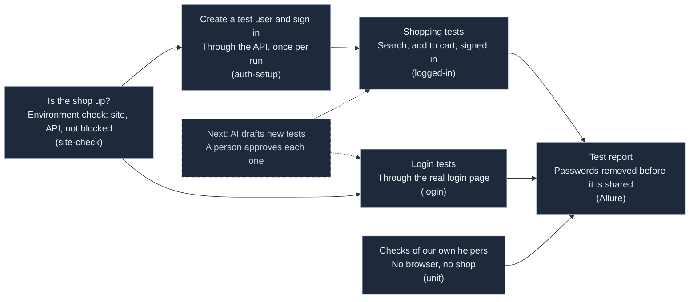

# playwright-qa-agent

A Playwright + TypeScript test framework for QA teams, with AI-drafted tests that a person reviews and approves
before they are merged. Built: 30 UI tests (login, search, cart, category filters, checkout), CI on every pull
request, a published test report, and a planted-bug run that measures what the tests catch.

**Latest test report (main):** https://rahulsharma-qe.github.io/playwright-qa-agent/

Tests run against **Toolshop**, the Sprint 5 version of the practice web shop by
[Testsmith](https://github.com/testsmith-io/practice-software-testing). The main path is a pinned local copy of
Toolshop, the same one CI starts inside its runner (see [Run it](#run-it) and [CI](#ci)).

> **The tests are pinned to Toolshop 2.5 (commit 9e7736c), which the local and CI copy run.** There, Payment has one
> finish button labelled "Confirm", clicked twice. The public site runs a newer version, where Payment shows "Check
> payment" before "Confirm", so the Payment tests fail there. Run the
> pinned copy with `ci/start-toolshop.sh` (see [Run it](#run-it)). With the default settings the tests run against
> the public site; a run there on 15-11-2026 failed 5 tests, all at the Payment step: "Invalid credit card fields
> show their messages and keep Confirm disabled" (3.1), "An invalid Bank Name shows its message and disables
> Confirm" (3.3), "An invalid Gift Card Number shows its message and disables Confirm" (3.4), "Happy path with a
> credit card" (4.1) and "Happy path with Cash on Delivery" (4.2).

**Proof of "AI drafts, a person decides":** pull request
[#24](https://github.com/rahulsharma-qe/playwright-qa-agent/pull/24): its first commit holds the AI test
generator's raw drafts byte for byte, its second commit the QA engineer's decisions, and every edit has a row with
its reason in the [drafting log](docs/ai-drafting-log.md).

## Built / Next / Later

**Built**
- The suite runs in five groups (Playwright "projects"). First an environment check (is the shop up?). After it,
  two paths: create a test user and sign in through the API, then the shopping tests (search, cart); and the login
  tests through the real login page. Checks of our own helpers run on their own.
- Node version in `.nvmrc`; site and API addresses from `.env` (both have defaults)
- Site check: stops the run with "Toolshop site (or API) is not responding … an environment problem, not a test failure"
- Each run registers its own Toolshop customers through the API (no shared account, no account secrets). The login
  tests log in through the page; the other tests start from a session made through the API and checked on the site
- Page objects (`pages/`) given to tests through `fixtures.ts`
- Login tests: login works · unknown email shows an error · wrong password shows the same error (on this run's own account)
- Search finds the product · add to cart makes the cart count go up; search terms and product names in `test-data/`
- Allure report (Allure 3, runs on Node, no Java): steps, retries. Screenshots and traces only on failed
  logged-in tests: they record what was typed, and the login tests type login details. A failed login test keeps
  a text snapshot instead.
  A secret scan replaces this run's test-account values in the results, and stops the report if a password is left
  anywhere except the CI log-mask line and the page snapshot of a failed test (both are replaced). It cannot
  look inside compressed files (traces, screenshots); those come only from logged-in tests, where no password is
  typed or printed
- Bot-check detection: if a site shows a bot check (such as Cloudflare's "Performing security verification")
  instead of Toolshop, in the site check or later in any test, the run stops with one clear message: an
  environment problem, not a test failure. We never try to get past it. Unit tests for the detector run in a
  `unit` project with no browser
- A hand-started planted-bug run on Toolshop's "with bugs" version; failures are matched to planted bugs by a
  person in [docs/bug-hunt.md](docs/bug-hunt.md)
- CI starts its own copy of Toolshop from pinned images, seeds it and waits for it, then runs the tests against it
- GitHub Actions on every pull request and push to main: a pass/fail table on the run page, and the Allure report
  attached to the run (`allure-report`), even when tests fail
- The report from main published on GitHub Pages (link at the top), also when tests fail
- Tags: `@sanity` (login works, search, one category filter, one order) and `@regression` (the rest); `npm run test:sanity` for a quick check after a deploy or a fix
- AI-assisted tests, one user flow at a time: Playwright's test agents explore the site, write a test plan and draft
  tests with our page objects; a person approves the plan and the tests in pull requests. Built for the category
  filters and checkout (25 of the 30 UI tests). Rules for the agents: [AGENTS.md](AGENTS.md); how to use them:
  [docs/ai-assisted-tests.md](docs/ai-assisted-tests.md); every drafted test and its outcome:
  [docs/ai-drafting-log.md](docs/ai-drafting-log.md)

**Next**
- Move the local and CI copy to the public site's Toolshop version, with a production build of its UI (no
  development server), then the Payment and address tests checked again
- The contact form flow, with a test plan written by the QA engineer in plain English and drafted by the AI test generator
- The planted-bug run again after step 2, to measure what the AI-drafted tests catch

**Later**
- A full agent: reads a requirement, plans tests, drafts them, heals broken locators; every change comes as a pull request a person approves
- Account lockout test (on our own copy) · accessibility checks · several environments · visual regression · UI error states by mocking API replies
- Allure history and trends · GitLab CI (explained by mapping from Actions)

## Design

How a test run works, from checking the shop is up to a shareable report.



The whole picture, how one test runs, and the CI run: [docs/architecture.md](docs/architecture.md#diagrams).

[High-level design](docs/architecture.md): goals, components, one run and one CI run step by step, safety,
decisions and limits. [Low-level design](docs/lld.md): projects, page objects, test accounts, reporting and the
secret scan, bot-check detection, CI and the Toolshop copy, settings and versions.

## Run it

```bash
nvm use                      # Node version from .nvmrc (22.18 or later: Node runs one TypeScript script directly)
npm ci
npx playwright install chromium
ci/start-toolshop.sh         # the pinned local copy of Toolshop (needs Docker; see CI below)
export BASE_URL=http://localhost:4200 API_URL=http://localhost:8091   # every command below runs on that copy
npm test                     # 64 tests: 32 unit, 2 set-up, 30 UI
npm run test:sanity          # only @sanity tests (setup still runs)
npm run test:ready           # the "ready" check: every test 3 times at 2 workers, as before a merge
npm run test:seed            # only the AI agents' starting test (npm test leaves it out)
npm run report               # build the Allure report and open it
ci/stop-toolshop.sh          # when you are done
```

Without `BASE_URL` and `API_URL` the commands run against the public site, which runs a newer Toolshop version
than the pinned one (see the note at the top).

A trace attached to a failed test opens with `npx playwright show-trace <file>` or at trace.playwright.dev.

## Settings

`BASE_URL`, `API_URL` and `SPRINT` (the Toolshop version) are the only settings, and all have defaults. There
are no account values anywhere: shared demo accounts get locked by other visitors, and accounts registered by
hand are removed when Toolshop resets its data. So each run registers two customers through Toolshop's API (one for the logged-in tests, one
for the login tests; one more per retry; in CI, one more for the agents' starting test). Their emails use the reserved `example.com` domain; the passwords are
generated for the run and kept only in `playwright/.auth/run-accounts/` (git-ignored), where the secret scan
reads them.

## CI

`.github/workflows/ui-tests.yml` runs on every pull request and push to main. Toolshop's public site shows a bot
check to CI machines, and we do not try to get past it, so CI starts its own copy first:

1. `ci/start-toolshop.sh` fetches Toolshop's compose file at a pinned commit, starts the database, API, web server
   and site from Toolshop's published images (pinned by digest in `ci/toolshop-images.sprint5.yml`), seeds the
   database, and waits until the API and the site answer. Toolshop's hourly data reset is not started.
2. `npm test` runs against `http://localhost:4200` (site) and `http://localhost:8091` (API), with 2 workers and 1 retry.
3. The report is built and scanned; `ci/stop-toolshop.sh` removes the containers.

Start the same copy on your machine (needs Docker):

```bash
ci/start-toolshop.sh
BASE_URL=http://localhost:4200 API_URL=http://localhost:8091 npm test
ci/stop-toolshop.sh
```

Before long runs, restart the local copy (`ci/stop-toolshop.sh`, then `ci/start-toolshop.sh`): it keeps every order
and cart it is given, and a copy left running for hours gets slower.

The copy uses host ports 3306 (database), 8000 and 8091 (API) and 4200 (site); free them first.
Toolshop's web server image is published for arm64 only. A Mac with Apple silicon runs it natively; Docker
Desktop on an Intel Mac or Windows emulates it on its own. On a Linux machine (amd64), turn on arm64 emulation
once: `docker run --privileged --rm tonistiigi/binfmt --install arm64`.

CI needs no secrets, so pull requests from forks run fully. Only a report that passed the secret scan is uploaded
or published. For the report on GitHub Pages, one-time setup: Settings → Pages → Source: "GitHub Actions". Pull
requests do not publish. No AI runs in CI: runs stay repeatable and cost nothing per run.

**Planted-bug run.** The hand-started workflow "Run on the with-bugs copy" runs the same tests on Toolshop's
version with bugs planted on purpose, to see which of them the tests catch ([docs/bug-hunt.md](docs/bug-hunt.md)).
Failed tests are the result there, so that workflow stays green when they fail. The same run on your machine:

```bash
SPRINT=sprint5-with-bugs ci/start-toolshop.sh
SPRINT=sprint5-with-bugs BASE_URL=http://localhost:4200 API_URL=http://localhost:8091 npm test
ci/stop-toolshop.sh
```

To update Toolshop in CI: change `TOOLSHOP_COMMIT` in `ci/toolshop-env.sh` and run `ci/pin-toolshop-images.sh`
(the two are one pair), start the local copy (`ci/check-toolshop-pair.sh` runs and stops on a mismatch), run the
tests on it, then let CI run on the new copy.

## How strong are the tests?

Toolshop has a second version with bugs planted on purpose, and Testsmith lists them. We run the same tests on it,
by hand, to see which planted bugs they catch.

- Of Toolshop's 94 planted bugs, 29 are on the pages these tests open (login, home and search, product page, cart).
- **First baseline (09-11-2026):** 1 caught. **Second baseline (10-11-2026):** 2 caught, after search and cart began
  to start from a session made through the API. Bugs the tests did not reach are not counted as missed.

Which bugs were caught and why, how we count, and every run: [docs/bug-hunt.md](docs/bug-hunt.md). The AI test
agents are kept away from that file and from the "with bugs" copy; these are guards, not a guarantee
([docs/ai-assisted-tests.md](docs/ai-assisted-tests.md)).

## How we write tests

Page objects come from `fixtures.ts`; a test asks for the ones it needs:

```ts
import { expect, test } from '../fixtures';

test('login works', { tag: '@sanity' }, async ({ loginPage, header }) => {
  await loginPage.open();                          // the real test opens it in beforeEach
  await loginPage.login(user, password);          // page object performs an action
  await expect(header.accountMenu).toBeVisible();  // only the test decides what is right
});
```

- No hard waits (`page.waitForTimeout`): Playwright already waits for elements.
- Locators by role or label first; `data-test` when there is no clear role or label. No CSS chains or XPath.
- Page objects describe the page and may return values; only tests call `expect`. Tests never write `new LoginPage(page)`.
- Page objects wrap each action in `test.step('…')`, so the report reads like a test case. Step names never hold
  login details.
- Check what the page shows with web-first assertions (`await expect(locator).toHaveText(…)`), or `expect.poll` for a
  value a page object returns. Never read a value once and compare it: the page may still be updating.
- A test that passes only on retry is **flaky**, not passed.

## Honest lines

- Five hand-written tests prove the framework; the AI-drafted tests (25) add a few user flows. Neither is the
  coverage of a shop. Small on purpose.
- Toolshop is shared by everyone and can be slow or down; the site check says when the environment, not a test, is the problem.
- Each run leaves throwaway accounts on Toolshop: two, plus one per order-placing test (orders on one account at
  the same moment collide, observed note 17), plus one more each time a retry starts a new worker; there is no API to delete them, and
  the site's resets clear them.
- Lockout after failed logins is not tested yet (Later: on an account made for it, on our own copy).
- CI tests its own copy of Toolshop Sprint 5, not the public site. Images are pinned, so Toolshop changes reach CI
  only when the pins are updated. The pins are Toolshop 2.5; the public site runs newer code and fails the Payment
  tests (see the note at the top). Starting Toolshop adds about a minute (Toolshop ready after 42 s in the first measured run) to
  every CI run.
- The with-bugs images are not yet checked against the pinned commit.
- One kind of failure cannot pass on a retry: Toolshop's API keeps a product list for 5 minutes, so an empty answer
  stays empty for a retry inside that time (observed note 21).
- Toolshop's web server image is published for arm64 only, so CI (amd64) runs it under emulation (QEMU); the
  other images run natively.
- The local copy (CI's own too) runs Toolshop's development server, which sometimes rebuilds the billing address
  form after a test has filled it; the checkout tests fill it again, at most twice, and each refill is shown in the
  report and counted on the run page. At 4 workers on a laptop, refills were more than 1 in 10 runs.
- The postal-code length check (2.3) is left out until the production build of the UI: the development server
  reset its form once in 44 runs.
- The checkout order tests wait for the site's own answer that it emptied the cart; a customer who leaves the
  confirmation page at once keeps a cart badge for an order already placed (observed note 16), which is not tested.
- Flakiness numbers are from a development-server copy of Toolshop.
- Toolshop's header shows "Testing Guide" on every page, the local copy too. The AI agents' page snapshots from
  the category-filters and checkout sessions show that button only; none shows the guide or the "with bugs" site
  open. The snapshots are what the sessions kept, not a full record.
- The CI copy is not fully offline: Toolshop checks new passwords against the Have I Been Pwned service, so a slow
  or unreachable service shows as "Could not register a test customer … environment problem".

## Credits

Toolshop is © Testsmith and is used with their permission for this non-commercial project:
[practice-software-testing](https://github.com/testsmith-io/practice-software-testing). Nothing of Toolshop's code
is copied into this repository; CI runs its published images privately and removes them after the run, including
the "with bugs" version, which is run only to measure how many planted bugs the tests catch.

## Licence

MIT, for this repository's own code. Toolshop is Testsmith's and runs under its own licence; its repository is
fetched into a cache folder outside this repository at run time, and nothing of it is committed here.
