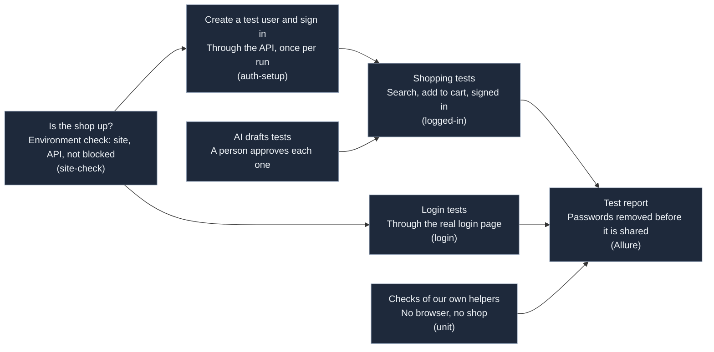

# playwright-qa-agent

A Playwright + TypeScript test framework for QA teams, with AI-drafted tests that a person reviews and approves
before they are merged. Built: 31 UI tests (login, search, cart, category filters, checkout), CI on every pull
request, a published test report, and a planted-bug run that measures what the tests catch.

**Latest test report (main):** https://rahulsharma-qe.github.io/playwright-qa-agent/

Tests run against **Toolshop**, the Sprint 5 practice web shop by [Testsmith](https://github.com/testsmith-io/practice-software-testing),
as a pinned local copy, the same one CI starts inside its runner ([the Toolshop copy](docs/running-the-tests.md#the-toolshop-copy)).

> **The tests are pinned to Toolshop 2.5 (commit 9e7736c), which the local and CI copy run.** The public site runs
> a newer version, where the Payment tests fail ([which tests, and why](docs/running-the-tests.md#run-against-the-public-site)).

**Proof of "AI drafts, a person decides":** pull request
[#24](https://github.com/rahulsharma-qe/playwright-qa-agent/pull/24): its first commit holds the AI test
generator's raw drafts byte for byte, its second commit the QA engineer's decisions, and every edit has a row with
its reason in the [drafting log](docs/ai-drafting-log.md).

## Built / Next / Later

**Built**
- 31 UI tests in five Playwright projects (see [Design](#design)); page objects (`pages/`) given to tests through
  `fixtures.ts`; search terms and product names in `test-data/`
- Application profiles (`support/apps/`, picked by `APP_UNDER_TEST` and `TEST_ENV`): on Toolshop each run registers
  its own customers through the API; a given-user mode for an application where tests cannot
  ([docs/onboarding-a-web-app.md](docs/onboarding-a-web-app.md))
- Three suites, each part of the next, by tag ([Suites](#suites)), with the tag rules checked in CI
- CI on every pull request and push to main, against its own Toolshop copy from pinned images; an Allure report on
  GitHub Pages; a secret scan removes this run's test-account values before anything is uploaded
- AI-assisted tests: Playwright's test agents plan and draft, a person approves the plan and the tests (category
  filters and checkout, 25 of the 31 UI tests); [AGENTS.md](AGENTS.md), [docs/ai-assisted-tests.md](docs/ai-assisted-tests.md)
- A hand-started planted-bug run that measures what the tests catch ([how strong are the tests?](docs/running-the-tests.md#planted-bug-run))

Everything built, in full: [docs/architecture.md](docs/architecture.md#built-in-full).

**Next**
- The contact form flow, with a test plan written by the QA engineer in plain English and drafted by the AI test generator
- The planted-bug run again after step 2, to measure what the AI-drafted tests catch
- Onboard a second application; its time measured, not estimated

**Later**
- Move the local and CI copy to the public site's Toolshop version, with a production build of its UI
- A full agent: reads a requirement, plans tests, drafts them, heals broken locators; every change comes as a pull request a person approves
- Account lockout test (on our own copy) · accessibility checks · several applications · visual regression · UI error states by mocking API replies
- Allure history and trends · GitLab CI (explained by mapping from Actions)

## Design

How a test run works, from checking the shop is up to a shareable report.



More diagrams: [docs/architecture.md](docs/architecture.md#diagrams). [High-level design](docs/architecture.md):
goals, components, safety, decisions and limits. [Low-level design](docs/lld.md): how each part is built.

## Run it

```bash
nvm use                      # Node version from .nvmrc (22.18 or later: Node runs one TypeScript script directly)
npm ci
npx playwright install chromium
ci/start-toolshop.sh         # the pinned local copy of Toolshop (needs Docker)
npm test                     # 90 tests: 57 unit, 2 set-up, 31 UI; no settings needed, the defaults are this copy
npm run test:sanity          # the sanity suite: login and search (set-up still runs)
npm run test:p0              # the P0 suite: login, search and placing an order
npm run test:regression      # the full suite: every UI test
npm run test:ready           # the "ready" check: every test but the seed 3 times at 2 workers, as before a merge
npm run test:unit            # only the unit tests (no Toolshop needed)
npm run test:seed            # only the AI agents' starting test (npm test leaves it out)
npm run report               # build the Allure report and open it
ci/stop-toolshop.sh          # when you are done
```

If the local copy is not running, the site check shows as 1 failed with this message, and the other tests do not
run: "The local Toolshop copy is not running. Start it with ci/start-toolshop.sh."

Settings, the public site, CI, the planted-bug run and the pins: [docs/running-the-tests.md](docs/running-the-tests.md).

## How we write tests

### Suites

Every UI test is in the full suite (`@regression`); a person adds `@p0` and `@sanity` on top, so each smaller suite
is part of the larger one. CI checks that: every UI test has `@regression`, a `@sanity` test also has `@p0`, and a
`@p0` test also has `@regression` (`support/tag-rules.ts`); AI-drafted tests come with `@regression` only.

P0 means the flows that must work; a person chooses them in the plan.

| Suite | Script | Tests |
|---|---|---|
| Sanity (`@sanity`) | `npm run test:sanity` | login works; search finds the product |
| P0 (`@p0`) | `npm run test:p0` | the sanity tests, and both order tests (credit card; Cash on Delivery) |
| Regression (`@regression`) | `npm run test:regression` | all 31 UI tests |

After a deploy, run `npm run test:sanity` (or `test:p0`) with `BASE_URL` and `API_URL` set to the deployed site.

Page objects come from `fixtures.ts`; a test asks for the ones it needs:
```ts
import { expect, test } from '../fixtures';

test('login works', { tag: ['@regression', '@p0', '@sanity'] }, async ({ loginPage, header }) => {
  await loginPage.open();                          // the real test opens it in beforeEach
  await loginPage.login(user, password);          // page object performs an action
  await expect(header.accountMenu).toBeVisible();  // only the test decides what is right
});
```

- No hard waits (`page.waitForTimeout`): Playwright already waits for elements.
- Locators by role or label first; `data-test` when there is no clear role or label. No CSS chains or XPath.
- Page objects describe the page and may return values; only tests call `expect`. Tests never write `new LoginPage(page)`.
- Page objects wrap each action in `test.step('…')`, so the report reads like a test case; no login details in it.
- Check what the page shows with web-first assertions (`await expect(locator).toHaveText(…)`), or `expect.poll` for a
  value a page object returns. Never read a value once and compare it: the page may still be updating.
- A test that passes only on retry is **flaky**, not passed.

## Honest lines

- The tests run a pinned copy of Toolshop 2.5; the public site runs newer code, where the Payment tests fail.
- Six hand-written tests (the five originals and the given-user example) prove the framework; the AI-drafted tests
  (25) add a few user flows. Neither is the coverage of a shop. Small on purpose.
- Flakiness numbers are from a development-server copy of Toolshop.
- Only one application (Toolshop) uses a profile so far; a second one's onboarding time will be measured.
- The planted-bug numbers are for the five original tests; the newer tests are first measured after step 2.
- The given-user mode is shown by one example on Toolshop; its set-up path and the one-worker rule have run only
  through the test list and CI's count step, not yet against an application without registration.

More, with their reasons: [docs/architecture.md](docs/architecture.md#10-limits).

## Credits

Toolshop is © Testsmith and is used with their permission for this non-commercial project:
[practice-software-testing](https://github.com/testsmith-io/practice-software-testing). Nothing of Toolshop's code
is copied into this repository; CI runs its published images privately and removes them after the run, including
the "with bugs" version, which is run only to measure how many planted bugs the tests catch.

## Licence

MIT, for this repository's own code. Toolshop is Testsmith's and runs under its own licence; its repository is
fetched into a cache folder outside this repository at run time, and nothing of it is committed here.