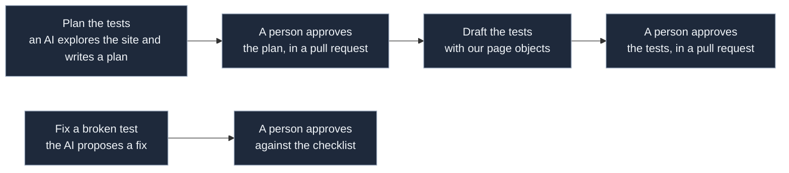

# AI-assisted tests

**Agents run only on the normal Sprint 5 copy of Toolshop, started locally with `ci/start-toolshop.sh`. Never on the
"with bugs" copy.**

Writing UI tests for every page by hand takes long. Here an AI drafts them and a person decides. We use Playwright's
own test agents: the **planner** explores the site and writes a test plan in `specs/`; the **generator** turns a
plan into tests that use our fixtures and page objects; the **healer** proposes a fix for a failing test. They run on
a person's machine, inside their AI assistant. **No AI runs in CI**, and nothing is merged without a person's
approval.

## One-time set-up

1. Start the normal Sprint 5 copy: `ci/start-toolshop.sh` (it uses `SPRINT=sprint5` by default). In `.env`, set
   `BASE_URL=http://localhost:4200` and `API_URL=http://localhost:8091` (the addresses it prints), and no `SPRINT`
   other than `sprint5`.
2. Write the agent files for your assistant:
   `npx playwright init-agents --loop=<your assistant> --project logged-in`
   (`--loop` is one of `claude`, `codex`, `copilot`, `opencode`, `vscode`). `--project logged-in` matters: without it,
   the agents use the first project in the config, which is `unit`.
3. The files it writes are generated and git-ignored; write them again after each Playwright update. Only the
   generated `copilot-setup-steps.yml` is ignored in `.github/workflows/`; the folder and our workflows stay tracked.

The agents start from `tests/seed.spec.ts`: our fixtures and a signed-in home page. Each time, they first run the
environment check and the test-user set-up, as the tests do. The seed stops with "Agents must run on the normal
Sprint 5 copy; stop it and start with SPRINT=sprint5" if it is on any other copy.

## Plan, draft, fix

1. **Plan.** Ask your assistant "plan tests for <a part of the site>". The planner writes `specs/<name>.md`. Open
   **pull request 1: the plan**. A person edits and approves it. A plan can also be written by a person in plain
   English and given to the generator.
2. **Draft.** Ask "generate tests from specs/<name>.md". Open **pull request 2: the tests**. First commit: the raw
   draft as the agent wrote it. Second commit: the person's edits. Add one row per drafted test to
   [ai-drafting-log.md](ai-drafting-log.md) in the same pull request. CI green, then merge.
3. **Fix.** When a test breaks, ask "heal <the test>". The healer proposes a fix. **Pull request 3: the fix**, checked
   against the list in the pull-request template: no new wait, no new `skip`, no weaker assertion.

The rules every assistant follows (locators, page objects, tags, what not to read) are in [AGENTS.md](../AGENTS.md).

## Keeping the planted bugs away from the agents

This suite is measured on Toolshop's "with bugs" copy. To keep that measure fair, the agents never see it:

- `AGENTS.md` lists files not to read; a committed `.claude/settings.json` blocks the same list in Claude Code.
- The seed test refuses any copy but the normal Sprint 5 one.
- Every plan and tests pull request has the checklist line "Nothing here is taken from the planted-bug list".

These are guards, not a guarantee. The person approving has read the planted-bug list; every edit and its reason is
in the drafting log.

## Honest lines

- The AI drafts; a person decides.
- The numbers come from small samples.
- The healer is shown on a deliberately broken locator, as a demo on a branch that is not merged.
