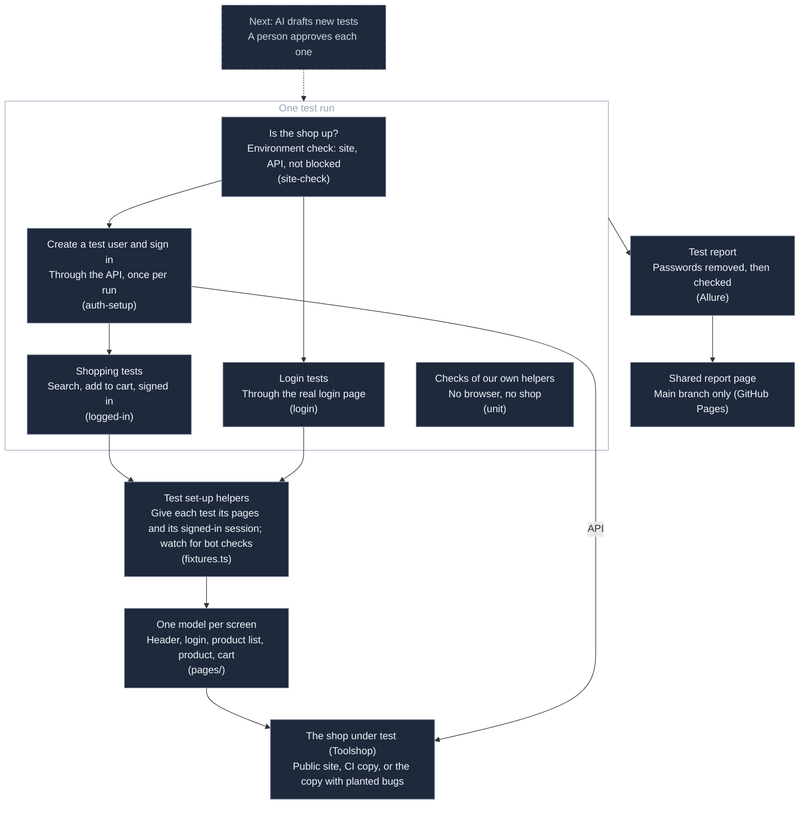
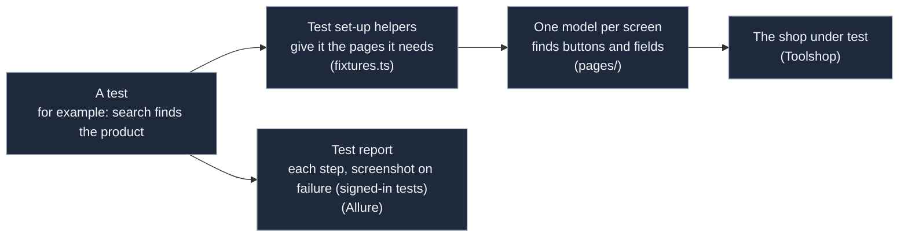
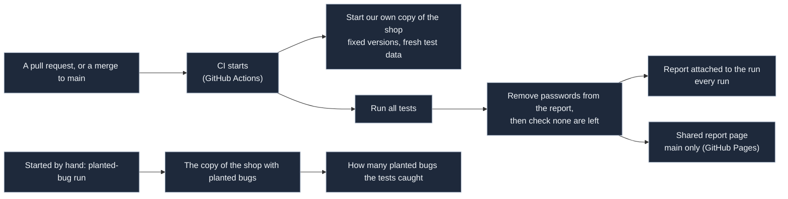

# playwright-qa-agent: high-level design

**A Playwright + TypeScript test framework for QA teams; next, AI agents draft tests and a person approves them.**

Status: step 1, the framework, is built. Step 2, AI agents that plan and draft tests, is next and not built; its
design comes separately. The README's Built / Next / Later list is the record. How each part is built:
[lld.md](lld.md).

## Diagrams

The whole picture:

The environment check, the test-user set-up and the login tests' own test user also call the shop's API directly.

How one test runs:

One CI run:

## 1. Goals and non-goals

**Goals**

1. **Easy to read and extend.** Tests ask for the page objects they need; adding a page object is one line in
   `fixtures.ts`. A small set of tests shows every feature.
2. **A red run explains itself.** An environment problem (site or API down, a bot check, a registration that
   failed) is named as one before any test runs; a failed test has its steps, and on logged-in tests a
   screenshot and a trace.
3. **No secrets anywhere.** No account values in code, settings or CI; the public report is scanned before it is
   uploaded or published.
4. **Repeatable CI.** CI tests its own copy of the shop, started from pinned images.

**Non-goals**

- Coverage of a shop: five tests prove the framework, not the coverage of a shop. Small on purpose.
- Step 2 and the Later items (section 9) are not built.
- More than one browser in step 1.

## 2. Who uses it and what it talks to

- **QA engineers** run `npm test`, read the Allure report, and add tests and page objects. Reviewers read pull
  requests and the pass/fail table on the GitHub Actions run page.
- **Toolshop**, the Sprint 5 version of Testsmith's practice web shop
  ([practice-software-testing](https://github.com/testsmith-io/practice-software-testing)), is the application
  under test: the **public site** (practicesoftwaretesting.com and its API) for local runs, and **its own copy**,
  started from Toolshop's published images, in CI.
- **Toolshop's API** is also called directly: the site check reads its brands list, and each run registers its
  own test customers through it.
- **GitHub Actions** runs CI; **GitHub Pages** hosts the report from main.

## 3. Components

| Component | What it does |
|---|---|
| `pages/` and `fixtures.ts` | Page objects (`Header`, `LoginPage`, `ProductListPage`, `ProductPage`, `CartPage`) given to tests through fixtures; the fixtures also watch every page for a bot check |
| Setup projects | `site-check` (site and API up, not a bot check) and `auth-setup` (register a customer, make the session through the API, check it on the site, save it) |
| Tests | Login (3), search, cart; tagged `@sanity` or `@regression`; a `unit` project for our own helpers |
| `support/` | Settings, test-account registration, the bot-check detector, the secret scan |
| Allure | `allure-playwright` writes results; Allure 3 (on Node) builds the report |
| Job summary | A pass/fail table on the GitHub Actions run page |
| `redact` / `check` | The secret scan before and after the report is built |
| `ci/` | Start, wait for and stop the CI copy of Toolshop; image pins and the script that writes them |

## 4. One run, step by step

1. **Site check:** the site and the API's brands list answer, and neither is a bot-check page. Otherwise the run
   stops with an environment message.
2. **Register:** `auth-setup` registers this run's customer through the API.
3. **Session:** `auth-setup` logs in through the API, checks the token with `/users/me`, gives it to the site,
   checks that "Sign in" is gone, and saves the session for the logged-in tests. Logging in through the page is
   tested by the login tests.
4. **Tests:** the login tests start logged out and register their own customer; search and cart use the saved
   session. The `unit` tests run without a browser.
5. **Report:** `npm run report` runs `redact`, builds the Allure report, runs `check`, and opens it.

## 5. One CI run, step by step

1. Node from `.nvmrc`, `npm ci`, Chromium.
2. **Start its own Toolshop** from pinned images (database, API, web server, site); Toolshop's web server image is
   published for arm64 only, so it runs under QEMU.
3. **Seed** the database, retried until the database and the API code are ready.
4. **Wait** until the API and the site answer.
5. **Tests** against `localhost`.
6. **`redact`** → **build the report** → **`check`**: a report is built only if Toolshop started.
7. **Upload** the report as a run artifact, only if `check` passed; on main, publish it on GitHub Pages.
8. **Stop** Toolshop and remove its data, always.

## 6. Safety

- **No account secrets.** Each run registers its own customers; their passwords are generated for the run, never
  printed, and kept only in a git-ignored folder the secret scan reads.
- **No typed values in report steps.** Allure's automatic action steps are off; our step names never hold a value.
- **Screenshots and traces only on `logged-in` tests,** where nothing is typed. The secret scan cannot read
  compressed files (screenshots, traces), so this rule is their guard.
- **The secret scan.** `redact` replaces the run's emails and passwords in the results; two places are expected
  to hold a password (the CI log-mask line and a failed test's page snapshot) and anything else stops CI. `check`
  then reads every file of the results and the report; a password found means no report.
- **No bypassing bot checks.** A bot check is named as an environment problem; CI tests its own copy instead.
- **Wrong passwords only against the run's own account,** never one someone else needs.

## 7. Quality attributes

- **Flaky is visible:** CI retries once; a test that passes only on retry is flaky, not passed, and Allure shows
  the retry.
- **Repeatable:** Node version in `.nvmrc`; npm packages, GitHub Actions and Toolshop images pinned; no AI in CI.
- **Environment problems named as such:** site or API down, a bot check, a failed registration, a Toolshop copy
  that did not start; each with its own message that says it is not a test failure.
- **Readable:** steps in the report read like a test case; tests and page objects follow the rules in the README.

## 8. Key decisions and trade-offs

| Decision | Why | Cost |
|---|---|---|
| Each run registers its own customers | Shared demo accounts get locked by other visitors; accounts registered by hand disappear in the public site's hourly reset | Two throwaway accounts per run (one more per retry) left on the site |
| Locators by role or label first, `data-test` as fallback | Playwright's own guidance; a role locator also breaks when the page's accessibility breaks | A few elements need the fallback, and the page object says why |
| Own Toolshop copy in CI | The public site shows a bot check to CI machines; a pinned copy is not changed by other visitors | Adds about a minute (Toolshop ready after 42 s in the first measured run) to each CI run; CI does not test the public site |
| Toolshop's `cron` left out in CI | It re-seeds the database every hour | None for a run of about a minute (Toolshop ready after 42 s in the first measured run) |
| Toolshop's web server image under QEMU | It is published for arm64 only | Emulation on an amd64 runner (it only passes requests on) |
| A Playwright project `unit` for our helpers | Runs TypeScript with no extra tool and never waits for Toolshop | Unit tests show in the same report as UI tests |
| Screenshots and traces only on logged-in tests | They record what is typed, and the scan cannot read inside them | A failed login test has its message, steps and page snapshot, but no screenshot |

## 9. Steps

- **Step 1 (built):** the framework, its report, CI with its own Toolshop copy, and the report on GitHub Pages.
- **Planted-bug baseline (before step 2):** a hand-started workflow runs the same tests on Toolshop's "with bugs"
  version; a person matches failures to planted bugs ([bug-hunt.md](bug-hunt.md)). After step 2, the same run
  shows what the approved AI-drafted tests add.
- **Step 2 (next; its design comes separately):** Playwright's own test agents: a planner writes a test plan, a
  generator drafts tests from it with our page objects, and a healer proposes fixes for failing tests. A person
  approves the plan, the tests and every fix in a pull request.
- **Later:** account lockout test on our own copy · accessibility
  checks · several environments · visual regression · UI error states by mocking API replies · plain-English
  steps to a test script · Allure history and trends · a weekly run on both the public site and the CI copy ·
  GitLab CI (explained by mapping from GitHub Actions) · GitHub Actions pinned to commit SHAs.

## 10. Limits

- CI tests a pinned copy of Toolshop, not the public site; the public site is tested by local runs. Toolshop
  changes reach CI only when the pins are updated.
- Each run leaves two throwaway accounts on the site it tests; the public site's hourly reset clears them.
- Registration checks new passwords against the Have I Been Pwned service, so the CI copy is not fully offline.
- Starting Toolshop adds about a minute (Toolshop ready after 42 s in the first measured run) to a CI run.
- Five tests prove the framework, not the coverage of a shop.
