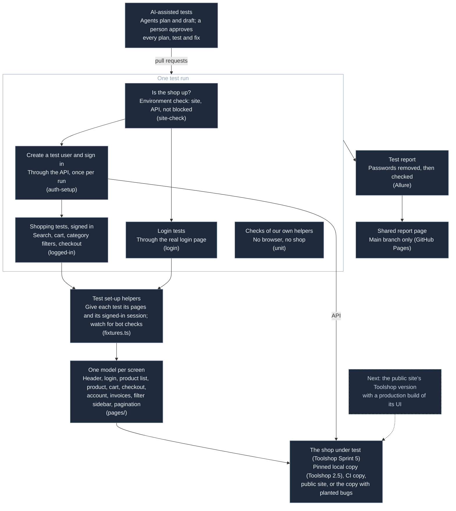
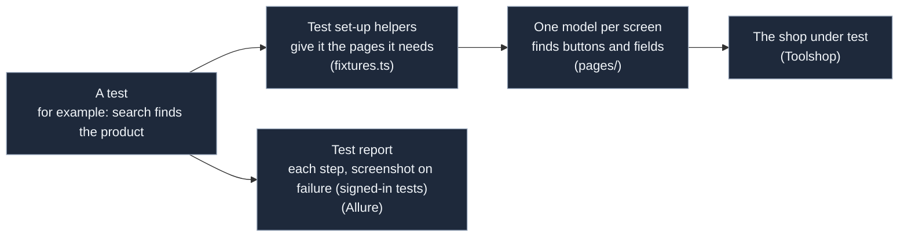
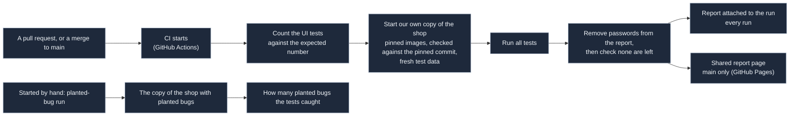

# playwright-qa-agent: high-level design

**A Playwright + TypeScript test framework for QA teams, with AI-drafted tests that a person reviews and approves
before they are merged.**

Status: step 1, the framework, is built, with application profiles, a given-user mode and three suites. Step 2,
AI-assisted tests, is being built one user flow at a time: the category filters and checkout flows are merged. Next: moving the local and CI copy of Toolshop to the public site's
version, together with a production build of its UI. The README's Built / Next / Later list is the record. How each
part is built: [lld.md](lld.md).

## Diagrams

The whole picture:

The environment check, the test-user set-up, the login tests' own test user and each order test's own customer
also call the shop's API directly.

How one test runs:

One CI run:

## 1. Goals and non-goals

**Goals**

1. **Easy to read and extend.** Tests ask for the page objects they need; adding a page object is one line in
   `fixtures.ts`. A small set of tests shows every feature.
2. **A red run explains itself.** An environment problem (site or API down, a bot check, a registration that
   failed, an expired login) is named as one; a failed test has its steps, and on logged-in tests a screenshot and
   a trace.
3. **No secrets in the repository or the report.** On Toolshop, no account values in code, settings or CI; an
   application with a given test user keeps its password in a CI secret, never in the repository. The public report
   and the JSON results are scanned before they are uploaded or published.
4. **Repeatable CI.** CI tests its own copy of the shop, started from pinned images that match the pinned commit.
5. **AI drafts, a person decides.** AI agents plan and draft tests; a person approves every plan, test and fix in a
   pull request, and the drafting log shows what was kept, edited or rejected.

**Non-goals**

- Coverage of a shop: six hand-written tests (the five originals and the given-user example) prove the framework; the AI-drafted tests add a few user flows.
  Neither is the coverage of a shop. Small on purpose.
- The Later items (section 9) are not built.
- AI in CI: CI runs the tests only, never an AI agent.
- More than one browser.

## 2. Who uses it and what it talks to

- **QA engineers** run the tests, read the Allure report, add tests and page objects, and approve the AI agents'
  plans, tests and fixes. Reviewers read pull requests and the pass/fail table on the GitHub Actions run page.
- **Toolshop**, the Sprint 5 version of Testsmith's practice web shop
  ([practice-software-testing](https://github.com/testsmith-io/practice-software-testing)), is the application
  under test. The tests are pinned to **Toolshop 2.5 (commit `9e7736c`)**, and the published images they run match
  that commit (a pair check proves it before each Sprint 5 start). The **pinned local copy** (`ci/start-toolshop.sh`) is the
  main path, and the default settings point at it; CI starts **its own copy** of the same version. The **public
  site** runs newer code, where the Payment tests fail; `npm run test:public-site` runs against it.
- **Other applications** get a profile of their own in `support/apps/` (picked by `APP_UNDER_TEST`, with
  `TEST_ENV` for the environment); Toolshop is the only one so far
  ([onboarding-a-web-app.md](onboarding-a-web-app.md)).
- **Toolshop's API** is also called directly: the site check reads its brands list, each run registers its own
  test customers through it, and the logged-in session is made through it.
- **GitHub Actions** runs CI; **GitHub Pages** hosts the report from main.

## 3. Components

| Component | What it does |
|---|---|
| `pages/` and `fixtures.ts` | Ten page objects (`Header`, `LoginPage`, `ProductListPage`, `ProductPage`, `CartPage`, `CheckoutPage`, `AccountPage`, `InvoicesPage`, `FilterSidebar`, `Pagination`) given to tests through fixtures; the fixtures also watch every page for a bot check and give logged-in pages their session |
| Setup projects | `site-check` (site and API up, not a bot check) and `auth-setup` (register a customer, make the session through the API, check it on the site, save it) |
| Tests | Login, search and cart, and the given-user example (hand-written); category filters and checkout (drafted by AI agents, decided by the QA engineer); three suites by tag, each part of the next: `@sanity`, `@p0`, `@regression`; a `unit` project for our own helpers |
| `support/apps/` | One profile per application under test: its environments (addresses and each copy's differences), health checks and test user (`register` or `given`) |
| `support/` | Settings, the API helper, test-account registration and the given test user, the API session, the bot-check detector, environment messages, the secret scan, the run-page summaries, the test-count check with the tag and name rules, and the run comparison |
| Allure | `allure-playwright` writes results; Allure 3 (on Node) builds the report |
| Job summary | A pass/fail table on the GitHub Actions run page, plus our counts line (UI tests and framework checks apart) and lines for billing-address refills and the cart being emptied after an order |
| `redact` / `check` | The secret scan before and after the report is built, over the Allure results, Playwright's JSON results and the report |
| `playwright-json` artifact and `compare-runs.ts` | Playwright's JSON results uploaded on their own; the comparison says whether two runs ended the same way, test by test, never showing a value |
| `ci/` | Start, wait for and stop the local and CI copy of Toolshop; image pins, the script that writes them, and the pair check |
| AI test agents | Playwright's own planner, generator and healer, run on a person's machine; they follow `AGENTS.md`, and a deny list keeps the planted-bug list away from them |

## 4. One run, step by step

1. **Site check:** the site and the API's brands list answer, and neither is a bot-check page. Otherwise the run
   stops with an environment message.
2. **Register:** `auth-setup` registers this run's customer through the API.
3. **Session:** `auth-setup` logs in through the API, checks the token with `/users/me`, gives it to the site,
   checks that "Sign in" is gone, and saves the session for the logged-in tests. Logging in through the page is
   tested by the login tests.
4. **Tests:** the login tests start logged out and register their own customer; the other tests use the saved
   session, and each test that places an order registers its own customer. The `unit` tests run without a browser.
5. **Report:** `npm run report` runs `redact`, builds the Allure report, runs `check`, and opens it.

## 5. One CI run, step by step

1. Node from `.nvmrc`, `npm ci`.
2. **Count the UI tests:** the list of tests is compared with the expected number; a difference stops CI.
3. Chromium.
4. **Start its own Toolshop** from pinned images (database, API, web server, site), after checking that the images
   match the pinned commit. Toolshop's web server image is published for arm64 only, so it runs under QEMU.
5. **Seed** the database, retried until the database and the API code are ready; the attempts and the finish time
   are printed and kept in a log.
6. **Wait** until the API and the site answer.
7. **Tests** against `localhost`; then the run-page lines (billing-address refills, the cart being emptied) and the
   AI agents' starting test in its own step.
8. **`redact`** → **build the report** → **`check`**: a report is built only if Toolshop started.
9. **Upload** the report as a run artifact, only if `check` passed; on main, publish it on GitHub Pages.
10. **Stop** Toolshop and remove its data, always.

## 6. Safety

- **No account secrets on Toolshop.** Each run registers its own customers; their passwords are generated for the
  run, never printed, and kept only in a git-ignored folder the secret scan reads. A given test user's password
  (another application) comes from a CI secret, is masked in the CI log and is scanned too.
- **No typed values in report steps.** Allure's automatic action steps are off; our step names never hold a value.
- **Screenshots and traces only on `logged-in` tests,** where no password is typed. The secret scan cannot read
  compressed files (screenshots, traces), so this rule is their guard.
- **The secret scan.** `redact` replaces the run's emails and passwords in the Allure results and Playwright's
  JSON results, in their raw, JSON-escaped and HTML-escaped forms; two places are expected
  to hold a password (the CI log-mask line and a failed test's page snapshot) and anything else stops CI. `check`
  then reads every file of the results, the JSON results and the report; a password found means nothing is
  uploaded.
- **No bypassing bot checks.** A bot check is named as an environment problem; CI tests its own copy instead.
- **Wrong passwords only against the run's own account,** never one someone else needs.
- **The planted-bug list is kept away from test writing.** Only `docs/bug-hunt.md` describes planted bugs. The AI
  agents run on the normal Sprint 5 copy only; `AGENTS.md` and a committed deny list keep them from reading that
  file, the with-bugs pins and workflow, and Toolshop's source; tests are never written or changed from the list.
  These are guards, not a guarantee.

## 7. Quality attributes

- **Flaky is visible:** CI retries once; a test that passes only on retry is flaky, not passed, and Allure shows
  the retry.
- **Ready before merge:** a new or changed test is ready only when `npm run test:ready` (every test but the seed, 3
  times at 2 workers, on a freshly started local copy) passes every time and three CI runs are green. One failure is a flaky
  test: fixed or left out with its reason, never merged.
- **Observed notes are never asserted:** behaviour the team has not decided on is an open question in
  [observed-notes.md](observed-notes.md), with who saw it and when.
- **No hard waits:** tests wait for what the page shows or for the site's own answer, never for a timer.
- **Repeatable:** Node version in `.nvmrc`; npm packages and Toolshop images pinned, GitHub Actions pinned
  to commit SHAs; the images checked against the pinned commit; no AI in CI.
- **Environment problems named as such:** site or API down, a bot check, a failed registration, an expired login,
  a Toolshop copy that did not start; each with its own message that says it is not a test failure.
- **Readable:** steps in the report read like a test case; tests and page objects follow the rules in the README.

## 8. Key decisions and trade-offs

| Decision | Why | Cost |
|---|---|---|
| On Toolshop, each run registers its own customers, including one per order-placing test | Shared demo accounts get locked by other visitors; accounts registered by hand disappear in the public site's hourly reset; two workers ordering on one account got the same invoice number | Throwaway accounts left on the site: five per run (session, login, two orders, the given-user example), one more in CI for the seed, one more per new worker after a retry |
| One profile per application, with a `register` or `given` test user | The generic parts (environment check, session, API helper, secret scan, reporting) stay the same for every application | Only one application uses it so far; the second one will show what is still Toolshop's |
| Three nested suites by tag, checked in CI | A person chooses P0 in the plan; CI checks the nesting and that no test name holds a tag, because `--grep` reads names | Tags are test-file changes, reviewed like any other |
| Locators by role or label first, `data-test` as fallback | Playwright's own guidance; a role locator also breaks when the page's accessibility breaks | A few elements need the fallback, and the page object says why |
| Own Toolshop copy in CI | The public site shows a bot check to CI machines; a pinned copy is not changed by other visitors | Each CI run pulls the images and starts Toolshop; CI does not test the public site |
| Pinned to Toolshop 2.5, with a pair check | The published images were built from that commit; the check proves the images and the commit are one pair | The public site runs newer code, where the Payment tests fail; moving to it is the next design |
| Toolshop's `cron` left out | It re-seeds the database every hour | None for a run of a few minutes |
| Toolshop's web server image under QEMU | It is published for arm64 only | Emulation on an amd64 runner (it only passes requests on) |
| A Playwright project `unit` for our helpers | Runs TypeScript with no extra tool and never waits for Toolshop | Unit tests show in the same report as UI tests |
| Screenshots and traces only on logged-in tests | They record what is typed, and the scan cannot read inside them | A failed login test has its message, steps and page snapshot, but no screenshot |
| Playwright's own test agents, with a person approving the plan, the tests and every fix | Drafting is faster; trust stays with the person; the raw draft and the person's decisions are separate commits | Every flow needs a person's review; numbers come from small samples |
| A test that cannot be made reliable is left out with its reason, not skipped | A skipped test reads as covered; a left-out one is visible in the plan and the drafting log | Fewer tests until the cause is fixed |

## 9. Steps

- **Step 1 (built):** the framework, its report, CI with its own Toolshop copy, and the report on GitHub Pages.
- **Framework clean-up (built):** application profiles, a given-user mode, three suites with their tag and name
  rules, Playwright's JSON results as an artifact, the run comparison, a `Pagination` page object, typed category
  names, GitHub Actions pinned to commit SHAs, and an onboarding guide ([onboarding-a-web-app.md](onboarding-a-web-app.md)).
- **Planted-bug baselines (built):** a hand-started workflow runs the same tests on Toolshop's "with bugs" version;
  a person matches failures to planted bugs ([bug-hunt.md](bug-hunt.md)).
- **Step 2 (being built, one user flow at a time):** Playwright's own test agents: a planner writes a test plan, a
  generator drafts tests from it with our page objects, and a healer proposes fixes for failing tests. A person
  approves the plan, the tests and every fix in a pull request ([ai-assisted-tests.md](ai-assisted-tests.md)).
  Category filters and checkout are merged.
- **Next:** moving the local and CI copy to the public site's Toolshop version together with a production build of
  its UI, as one design delivered in phases; then the contact form flow, with a plan written
  by the QA engineer; then the planted-bug run again, to measure what the AI-drafted tests catch.
- **Later:** account lockout test on our own copy · accessibility checks · several applications · visual
  regression · UI error states by mocking API replies · plain-English steps to a test script · Allure history and
  trends · a weekly run on both the public site and the CI copy · GitLab CI (explained by mapping from GitHub
  Actions) · a lint rule for the refused list.

## 10. Limits

- CI tests a pinned copy (Toolshop 2.5), not the public site, which runs newer code where the Payment tests fail.
  Toolshop changes reach CI only when the pins are updated.
- The with-bugs images are not yet checked against the pinned commit.
- Toolshop's API keeps a product list for 5 minutes, so an empty answer stays empty for a retry inside that time
  ([observed note 21](observed-notes.md)).
- Each run leaves throwaway accounts on the site it tests: on Toolshop five (session, login, two orders, the
  given-user example), plus one in CI for the seed, plus one per new worker after a retry; the public site's hourly
  reset clears them.
- Only one application (Toolshop) uses a profile so far; the given-user mode has run only through one example on
  Toolshop, the test list and CI's count step, not against an application without registration.
- Registration checks new passwords against the Have I Been Pwned service, so the CI copy is not fully offline.
- Flakiness numbers are from a development-server copy of Toolshop. That copy sometimes rebuilds the billing
  address form; tests refill it at most twice, and each refill is shown and counted.
- Two checks are left out with their reasons: the postal-code length check (2.3, checkout), until the production
  build of the UI, because the development server reset its form; and the price slider (3.3, category filters),
  which was flaky at 2 workers.
- The order tests' cart check depends on the site's own `DELETE` answer after the order; a customer who leaves the
  confirmation page before it keeps a badge for a cart already ordered (observed note 16).
- Starting Toolshop adds time to every CI run (images are pulled and the UI compiles when it starts).
