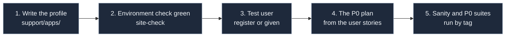

# Onboarding a web application

How a QA team points this framework at its own web application, from an empty profile to a sanity and a P0 suite
that run. Toolshop, the application this repository tests, is the worked example at every step.

There are five steps. Each one has something you can check before going on to the next:



## 1. Write the profile

Each application gets one file, `support/apps/<name>.ts`, and is listed in `support/apps/index.ts`. The shape is
`AppProfile` in `support/apps/app-profile.ts`:

| Field | What it says | Toolshop |
|---|---|---|
| `name` | what `APP_UNDER_TEST` selects | `toolshop` |
| `environments` | each place the application runs, with its site and API addresses and how that copy differs: `pagePrefix` (for example `/#` for hash routing), `tokenStore` (where the site keeps the login token), `signUpFields` | `local`, `public-site`, `with-bugs` |
| `healthChecks` | what the environment check calls before any test: a page of the site and an API path that needs no login | the home page and `/brands` |
| `testUser` | how the tests get a user: `register` (an account made at run time) or `given` (an account made for the tests) | `register` |

`APP_UNDER_TEST` picks the application (default `toolshop`). `TEST_ENV` picks its environment (default `local`).
`BASE_URL` and `API_URL` win over the environment's addresses when they are set, for example to point at a
deployed site. An unknown application or environment stops the run with one message that names the wrong value
and the valid ones.

**Check:** `npx playwright test --list` runs without a profile error.

## 2. Environment check green

```bash
APP_UNDER_TEST=<name> TEST_ENV=<environment> npx playwright test --project site-check
```

Replace `<name>` and `<environment>` with your own values. The run's first line says what it tests:
"Testing <name>, TEST_ENV=<environment>: site <url>, API <url>". When `BASE_URL` or `API_URL` win, the line says so
and where they came from.

The site check calls the profile's two health checks. If one does not answer, or answers with a bot-check page, the
run stops with an environment message ("… this is an environment problem, not a test failure"). In that case, no
test is counted as failed.

**Check:** the `site-check` project passes on the environment you will test.

## 3. Test user: `register` or `given`

**`register`** (Toolshop): each run makes its own accounts through the API, with emails on the reserved
`example.com` domain and passwords generated for the run. The passwords are kept only in
`playwright/.auth/run-accounts/` (git-ignored), and the secret scan reads them there. Nothing is stored in the
repository.

**`given`**: the tests log in as an account someone made for them. Its email and password come from
`APP_USER_EMAIL` and `APP_USER_PASSWORD`. Only these two names are in the repository. Set `canRegister` to say
whether the application still lets tests register their own accounts. The rules:

- **The wrong-password test never touches the given user.** It registers its own account when `canRegister` is
  true. When it is false, the test is left out with its reason, because wrong passwords could lock the one account
  every test needs.
- **Order tests never share an account between workers.** They register their own customer when `canRegister` is
  true. When it is false, they use the given user and the run uses one worker; the console says so.
- **In CI** the two values come from GitHub secrets with the same names. The password is sent to GitHub's log mask
  (`::add-mask::`), and the secret scan redacts and checks it like a registered password, in its raw, JSON-escaped
  and HTML-escaped forms.
- **A pull request from a fork gets no secrets**, so its run leaves out the projects that need a user
  (`auth-setup`, `logged-in`, `login`) and says so. The count check then exits 0 with that message. This rule is
  for `given` only: a `register` application such as Toolshop runs fully on a fork.

A missing `APP_USER_EMAIL` or `APP_USER_PASSWORD` stops the run with an environment message naming them.
`tests/given-user-login.spec.ts` is a working example on Toolshop: it registers an account, passes it in as a given
user, and logs in through the page.

**Check:** `npx playwright test --project auth-setup` passes, and `playwright/.auth/user.json` is written.

## 4. The P0 plan from the user stories

P0 means the flows that must work. Which tests are P0 is the QA engineer's decision in the plan, never the AI's.

1. Start from the application's user stories and their acceptance criteria. They say what is right. The site's
   behaviour, checked by hand, confirms it.
2. The AI test planner explores the site and drafts a plan in `specs/<flow>.md`. Alternatively, the QA engineer
   writes the plan in plain English. The plan names the user story and the criterion each scenario checks.
3. A person edits and approves the plan in a pull request: first commit the raw plan, second commit the edits.
   Each scenario's "Tag:" line says its suite, for example `Tag: @regression @p0`.
4. The AI test generator drafts the tests with the page objects through `fixtures.ts`. A person decides on each
   test in a pull request: first commit the raw draft under `drafts/<flow>/`, second commit the decisions in
   `tests/<flow>/`, with a row per test in `docs/ai-drafting-log.md`.
5. `EXPECTED_UI_TESTS` in `support/planted-bug-count.ts` changes in the same pull request as the tests.

The whole flow, with its checks after each agent session: [ai-assisted-tests.md](ai-assisted-tests.md). Rules for
the agents: [AGENTS.md](../AGENTS.md).

On Toolshop, P0 is: logging in with the right password, search finds the product, and the two order tests (credit
card; Cash on Delivery).

**Check:** the plan pull request is merged with its "Approved by" line, and the tests pull request passes
`npm run test:ready` and three CI runs.

## 5. The sanity and P0 suites

Every UI test carries `@regression`. A person adds `@p0` on top, and `@sanity` on top of `@p0`, so each smaller
suite is part of the larger one. AI-drafted tests come with `@regression` only.

```bash
npm run test:sanity
npm run test:p0
npm run test:regression
```

CI's count step checks these rules from the test list:

- every UI test has `@regression`;
- a `@sanity` test also has `@p0`;
- a `@p0` test also has `@regression`;
- no test's full name (file path, describe titles or test title) holds a suite tag. This matters because
  `--grep` also reads names.

A test that breaks a rule is named, and the step exits 1.

On Toolshop, sanity is logging in and search; after a deploy, run it with `BASE_URL` and `API_URL` set to the
deployed site.

**Check:** `npx playwright test --list --grep @p0` lists exactly the tests the plan tags `@p0`.

## Honest lines

- Only one application (Toolshop) uses a profile so far. Onboarding a second one is the next step, and its time
  will be measured, not estimated.
- The page objects and tests are Toolshop's. A new application brings its own, through `fixtures.ts`.
- The API calls for registering an account and making the session (`/users/register`, `/users/login`,
  `/users/me`) are Toolshop's and live in `support/` today. A second application's calls would move into its
  profile when it is onboarded.
- The `given` mode is shown by one example on Toolshop. Its set-up path (a session made with a given user) and the
  one-worker rule have run only through the test list and CI's count step, not yet against an application without
  registration.
